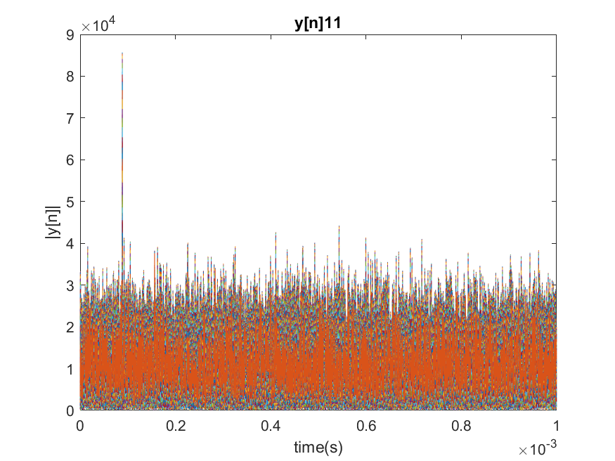
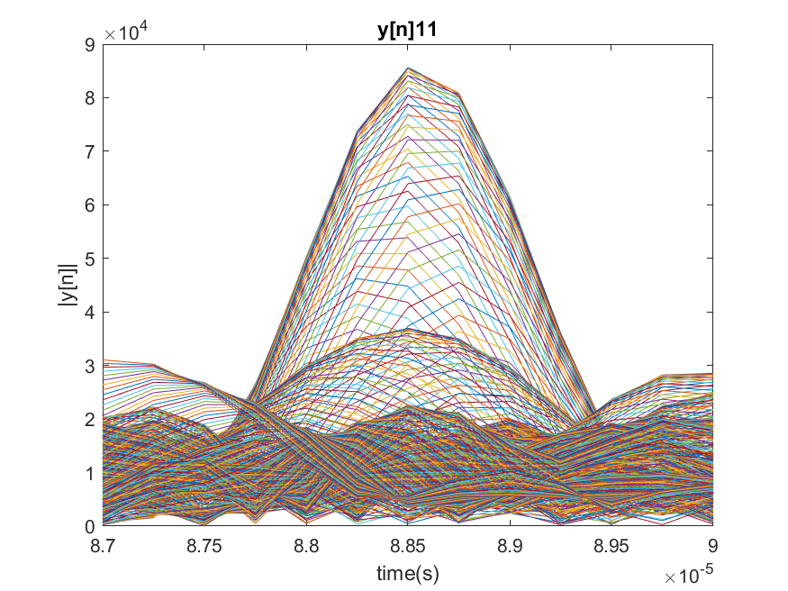
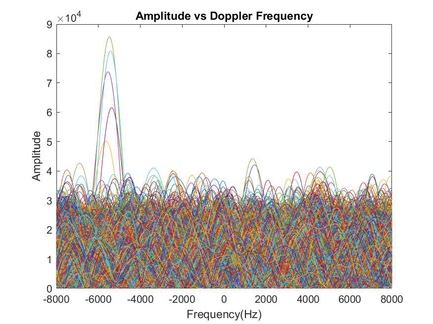

---
title: 'Lab 5 Part two Report'
author: 'Nathan Walker'
geometry: "left=3cm, right=3cm, top=2cm, bottom=2cm"
...

1. Make a table showing which satellites are visible. For each visible satellite, record the following

-The time delay t~o~ of the peak in seconds. The sample rate is 4 MS/s.So if the sample index of the peak is sample number n~o~, then the time delay of the peak is t~o~ = n~o~/4 * 10^6.

-The doppler frequency of the peak in Hertz. If the index of the peak in the "ksearch" array is k~o~, then the frequency F~o~ of the peak is F~o~ = (4 * 10^6)ksearch(k~o~)/N, where N is the FFT size.

|              | t~o~             | F~o~        |   K          |
| :---:        |  :---:           |  :---:      |   :---:      |
| satellite 1  |    .000997       |  -7050      |   -231       |
| satellite 11 |    .0000888      |   -5463     |   -179       |
| satellite 20 |    .000313       |    -8026    |   -263       |
| satellite 32 |    .000923       |     -6500   |   -213       |

2. Make plots as shown on the ECE 3640 website.

{ width=70% }

{ width=70% }

{ width=70% }

\pagebreak

the x-axis of the next figure is the index k for the ksearch array. Since the dot is at approximately 84, the dot is approximately at K~o~ = -179 or F~o~ = -5463. 

{ width=70% }

\pagebreak

# Appendix

## main.m

```
clear all
close all
clc

Fs = 4e6;

prn_code_id = [1:37];
for i=1:length(prn_code_id)
    mf(:,i) = build_matched_filter(prn_code_id(i),Fs);
end
[Nh,~] = size(mf);


N = 2^17;
MF = fft(mf,N);

Fmax = 8000;
Fmin = -Fmax;
Fbin = Fs/N;
KFmax = ceil(Fmax/Fbin);
KFmin = floor(Fmin/Fbin);
ksearch = [KFmin:KFmax];

fid = fopen('gps.dat','rb');
Nx = N - Nh + 1;
x = fread(fid,2*Nx, 'int16=>float32');
fclose(fid);
x = complex(x(1:2:end), x(2:2:end));

X = fft(x,N);
Lf = length(MF);

M = ones(1,37);
K = ones(1,37);
freqY = [-(N-1)/2:(N-1)/2]/N;

temp = [1 11 20 32];

tic
for i=size(MF)
    figure()
    %for plotting doppler frequency
    out = zeros(Nh,length(ksearch));
    for k=1:length(ksearch)
        y = ifft(circshift(X,ksearch(k)).*MF(:,i));
        y = y(length(mf):(2*length(mf))-1);
        n = length(y);
        plot((0:n-1)/Fs,abs(y));
        out(:,k) = y;
        hold on
        if abs(max(y)) > M(i)
            M(i) = abs(max(y));
            K(i) = ksearch(k);
        end
    end
    str = "y[n]" + i;
    title(str);
    xlabel('time(s)');
    ylabel('|y[n]|');
    hold off
    saveas(gcf, str, 'png');
    str = "zoomed_" + str;
    xlim([8.7e-5 9e-5])
    saveas(gcf, str, 'png');
    f = -(length(ksearch)-1)/2:(length(ksearch)-1)/2;
    figure();
    plot(f*Fbin,abs(out.'));
    title('Amplitude vs Doppler Frequency');
    xlabel('Frequency(Hz)');
    xlim([-8000 8000]);
    ylabel('Amplitude');
    saveas(gcf, 'Amplitude_vs_Doppler_Frequency', 'png');
    figure();
    imagesc(abs(out));
    title('Image of Amplitude vs Doppler Frequency')
    xlabel('Frequency(Hz)');
    ylabel('Sample');
    xlim([65 105]);
    ylim([340 370]);
    saveas(gcf, 'Image_of_Amplitude_vs_Doppler_Frequency', 'png');
    
end
toc

```
